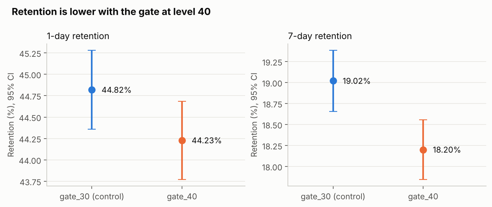

# A/B Test Analysis: Cookie Cats Gate Placement

**Question.** Should the mobile game Cookie Cats move its first progression gate from level 30 to level 40?

**Answer.** No. Moving the gate to level 40 lowers 7-day retention by 0.82 percentage points (19.02% → 18.20%, 95% CI −1.33 to −0.31, p = 0.0016). The probability that the later gate is better is about 0.1%.

**Recommendation.** Keep the gate at level 30, and test an even earlier gate next.



## Results at a glance

| Metric | gate_30 (control) | gate_40 | Difference | 95% CI | p-value |
|---|---|---|---|---|---|
| 7-day retention (primary) | 19.02% | 18.20% | −0.82 pp | [−1.33, −0.31] | 0.0016 |
| 1-day retention (secondary) | 44.82% | 44.23% | −0.59 pp | [−1.24, +0.06] | 0.074 |
| Mean game rounds (guardrail) | 51.34 | 51.30 | −0.04 | [−1.34, +1.33] | n/a (bootstrap) |

90,189 players, randomly assigned at install. Roughly 8 fewer players per 1,000 installs are still active after a week when the gate sits at level 40, with no offsetting gain in rounds played.

## What the analysis covers

1. **Data quality.** Missing values, duplicates, and one extreme outlier (49,854 rounds in 14 days, about 17 times the next highest player), which is excluded from the game-rounds analysis only.
2. **Sample Ratio Mismatch check.** The split is 44,700 vs 45,489 (chi-square p = 0.0086). This is above the common p < 0.001 stop threshold but worth flagging, and it is listed as a limitation.
3. **Frequentist test.** Two-proportion z-test with confidence intervals; the primary result holds under a Bonferroni correction for two retention metrics.
4. **Bayesian view.** Beta-Binomial model giving the probability that each variant is better and the expected loss of each decision.
5. **Guardrail metric.** Game rounds are heavily right-skewed (median 16 to 17, mean about 51), so the comparison uses a bootstrap interval and a Mann-Whitney test instead of a t-test.
6. **Sensitivity.** The test could detect a 0.73 pp change in 7-day retention at 80% power. The 1-day result is underpowered: confirming a 0.59 pp effect would need about 111,000 players per arm.

## Limitations

- The sample ratio check is borderline; the assignment pipeline should be verified before a final decision.
- No revenue data. The gate is also a monetisation point, so retention is only a proxy for business impact.
- Outcomes cover 14 days at most; effects on 30-day retention or lifetime value are unknown.
- No segment information (country, device, channel), so heterogeneous effects cannot be examined.

## Repository structure

```
├── notebooks/analysis.ipynb   # full analysis with outputs and interpretation
├── src/stats_utils.py         # reusable test functions (SRM, z-test, bootstrap, Bayesian, power)
├── figures/                   # charts generated by the notebook
├── data/README.md             # how to obtain the dataset
└── requirements.txt
```

## Reproduce

```bash
pip install -r requirements.txt
# place cookie_cats.csv in data/ (see data/README.md)
jupyter notebook notebooks/analysis.ipynb
```

## Data

[Mobile Games A/B Testing: Cookie Cats](https://www.kaggle.com/datasets/mursideyarkin/mobile-games-ab-testing-cookie-cats) on Kaggle, originally published by Tactile Entertainment through a DataCamp project. The raw file is not included in this repository.

## Author

Jing-Yi Evie Lai · [LinkedIn](https://www.linkedin.com/in/laijingyi/)
